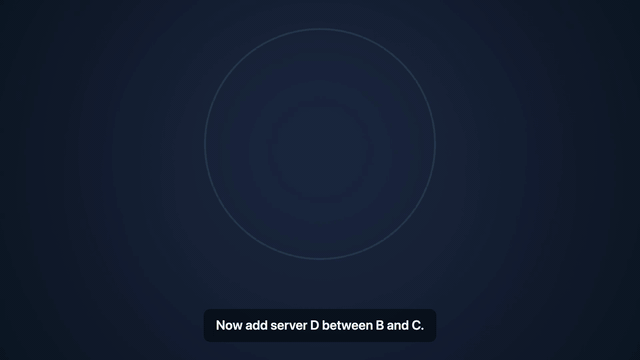

# openCanviz skills

[](https://opencanviz.com/blog/opencanviz-agent-skill-for-claude-code)

Agent skills for [openCanviz](https://opencanviz.com), which turns an outline into a narrated, animated explainer video.

The `opencanviz-json` skill teaches an AI agent to write openCanviz project JSON that you can paste into **Import** on [opencanviz.com/create](https://opencanviz.com/create). The agent plans scenes and steps, writes the JSON, checks it against the schema, and hands you a file that imports and plays.

The `launch-reel` skill makes a 40 to 70 second product launch video: short rising headlines and mock product UI (dashboards, an inbox, a phone screen, a pricing card) on colour fields, cut to music. The agent gathers facts about the product into a sources file, writes a short spec, and a builder does the layout and motion. Every price, figure, competitor, date and quote in the spec is checked against the sources before it builds. The agent then renders a contact sheet locally with [`@opencanviz/player`](https://www.npmjs.com/package/@opencanviz/player), looks at it, and revises.

openCanviz is our product. The skills are free and MIT licensed.

## What is in this repository

```text
.claude-plugin/marketplace.json          Claude Code marketplace listing
docs/demo.gif                            the demo above (not part of the plugin)
plugins/opencanviz/
  .claude-plugin/plugin.json             plugin manifest
  README.md                              plugin README
  skills/opencanviz-json/
    SKILL.md                             the skill: workflow, rules, checklist
    schema.json                          JSON Schema, same as https://opencanviz.com/schema/v1.json
    scripts/opencanviz.py                Python builder and validator (stdlib only, Python 3.9+)
    scripts/tex2svg.js                   LaTeX to SVG for math scenes (needs node and mathjax-full)
    examples/*.json                      22 complete projects that import and play
    examples/*.py                        the Python script that writes each example
    tests/test_examples.py               runs the examples and checks the validator refuses bad files
  skills/launch-reel/
    SKILL.md                             the skill: workflow, claim rules, scene choice, gotchas
    reference/scenes.md                  every scene type, its keys and length limits
    scripts/build.py                     spec to project JSON, with the claim checks
    scripts/launch_reel/                 the builder: scenes, styles, stories, audio, bundled icons.json
    scripts/preview.mjs                  contact sheet PNG or MP4 via headless Chromium and @opencanviz/player
    scripts/package.json                 the preview's dependencies (@opencanviz/player, playwright)
    examples/*/                          a suite, a developer API, a mobile app: spec.json + sources.md
    tests/                               builds every scene in every style, checks claims and examples
```

Agents that can run Python build the project with `scripts/opencanviz.py`, which lays out the nodes, fits the text, keeps captions and arrows readable, and refuses to save a file that breaks a rule. Agents that cannot run code write the JSON by hand from the rules in `SKILL.md`.

### Python example

```python
import sys; sys.path.insert(0, "plugins/opencanviz/skills/opencanviz-json/scripts")
from opencanviz import Project
p = Project("How caching works", aspect="16:9")
s = p.scene("Cache")
title, body = s.title("How caching works")  # every video opens with a title
app_r, cache_r, db_r = body.row(3, labels=["2 ms"], h=400)
app, cache, db = s.box("App", at=app_r), s.box("Cache", at=cache_r), s.node("cylinder", "Database", at=db_r)
s.step("Every request goes to the app.").reveal(title).reveal(app)
s.step("A cache keeps recent answers close.").reveal(cache).draw(s.arrow(app, cache, "2 ms"))
s.step("The database holds everything else.").reveal(db).draw(s.arrow(cache, db))
p.save("caching.json")  # validated; raises with a fix hint if a rule is broken
```

Check any openCanviz JSON file, hand-written or not, with `python3 plugins/opencanviz/skills/opencanviz-json/scripts/opencanviz.py check file.json`. Run the tests with `python3 -m unittest discover -s plugins/opencanviz/skills/opencanviz-json/tests`.

### Launch reel example

```bash
cd plugins/opencanviz/skills/launch-reel
python3 scripts/build.py examples/pinglet/spec.json --sources examples/pinglet/sources.md --out pinglet.json
(cd scripts && npm run setup)                 # once: @opencanviz/player and Chromium
node scripts/preview.mjs pinglet.json         # pinglet.sheet.png, one frame per scene
```

Run its tests with `python3 -m unittest discover -s plugins/opencanviz/skills/launch-reel/tests`.

## What it runs

- `python3`, to run the builder and validator in `scripts/opencanviz.py`, when the agent uses the helper. It uses only the standard library. If the `jsonschema` package happens to be installed, it also checks the file against `schema.json`; it is not required.
- `node` with the `mathjax-full` package, only for LaTeX math scenes. The math calls run `node scripts/tex2svg.js` locally. If Node or the package is missing, they stop and print the install line, `npm i mathjax-full`. Installing it downloads a package from npm.
- The skill makes no network calls and sends no data anywhere. You copy the JSON into openCanviz yourself.

`launch-reel` runs:

- `python3` (3.9+, standard library) for `scripts/build.py`. Optional: `numpy` and `scipy` to write the music and sound effects as a WAV (`--audio`), `Pillow` to embed screenshots (`--screenshot`).
- `node`, `npm` and Playwright's Chromium for `scripts/preview.mjs`, only when the agent previews. `npm run setup` downloads `@opencanviz/player` from npm and Chromium from the Playwright CDN. The preview serves the player from a local port and renders offline. `ffmpeg` is needed only for `--mp4`.
- Network: about 670 icons ship in `scripts/launch_reel/icons.json`, so a build makes no network calls. Only with `--fetch-icons` (or `LAUNCH_REEL_FETCH_ICONS=1`) does it fetch an icon that is not bundled from `api.iconify.design`, sending just the icon name. When the agent gathers facts, it reads the product's public pages with its own tools, not the skill's.
- The imported project has no music, since openCanviz projects carry narration rather than a music bed. For a video with the music, render the MP4 locally with `preview.mjs --mp4 --audio`.

## Account

The skill itself needs no account. Importing the file needs a free openCanviz account at [opencanviz.com/create](https://opencanviz.com/create). A free account can build and watch the video. Downloading the MP4 needs a plan, or a one-time purchase of that video's export.

## Install

### Claude Code

Add this repository as a plugin marketplace, then install the plugin:

```text
/plugin marketplace add opencanviz/opencanviz-skills-repo
/plugin install opencanviz@opencanviz-skills
```

Or from your shell:

```bash
claude plugin marketplace add opencanviz/opencanviz-skills-repo
claude plugin install opencanviz@opencanviz-skills
```

Then ask Claude for an openCanviz video as JSON, or run the skill directly with `/opencanviz:opencanviz-json`. For a launch video, ask for one or run `/opencanviz:launch-reel`.

To use a skill without the plugin system, copy its folder, for example `plugins/opencanviz/skills/opencanviz-json/`, to `~/.claude/skills/opencanviz-json/` (all your projects) or `.claude/skills/opencanviz-json/` (one project).

### Claude apps (claude.ai, desktop)

Download [opencanviz-json.zip](https://opencanviz.com/skills/opencanviz-json.zip), then in Claude open **Customize** > **Skills**, click **+**, choose **Create skill**, then **Upload a skill** and pick the zip.

### Other agents and chatbots

With the [skills CLI](https://github.com/vercel-labs/skills), which installs into Claude Code, Codex, Cursor and other agents:

```bash
npx skills add opencanviz/opencanviz-skills-repo
```

Or paste the contents of [SKILL.md](plugins/opencanviz/skills/opencanviz-json/SKILL.md) into the chat or your agent's system prompt, and attach `schema.json` and one of the examples if the tool allows files. Agents that read a skills folder can use the `opencanviz-json` folder as is.

## Use the result

1. Copy the JSON the agent writes.
2. Open [opencanviz.com/create](https://opencanviz.com/create) (sign in with a free account), choose **Import**, paste it and click **Import project**.
3. In the editor, open the **Narration** panel and click **Generate All Scenes** to voice the narration.

## Docs

- [The openCanviz JSON format](https://opencanviz.com/docs/json-overview)
- [JSON schema reference](https://opencanviz.com/docs/json-schema-reference)
- [JSON examples](https://opencanviz.com/docs/json-examples)
- [JSON rules for AI agents](https://opencanviz.com/docs/json-rules-for-ai-agents)

## License

MIT. See [LICENSE](LICENSE).
